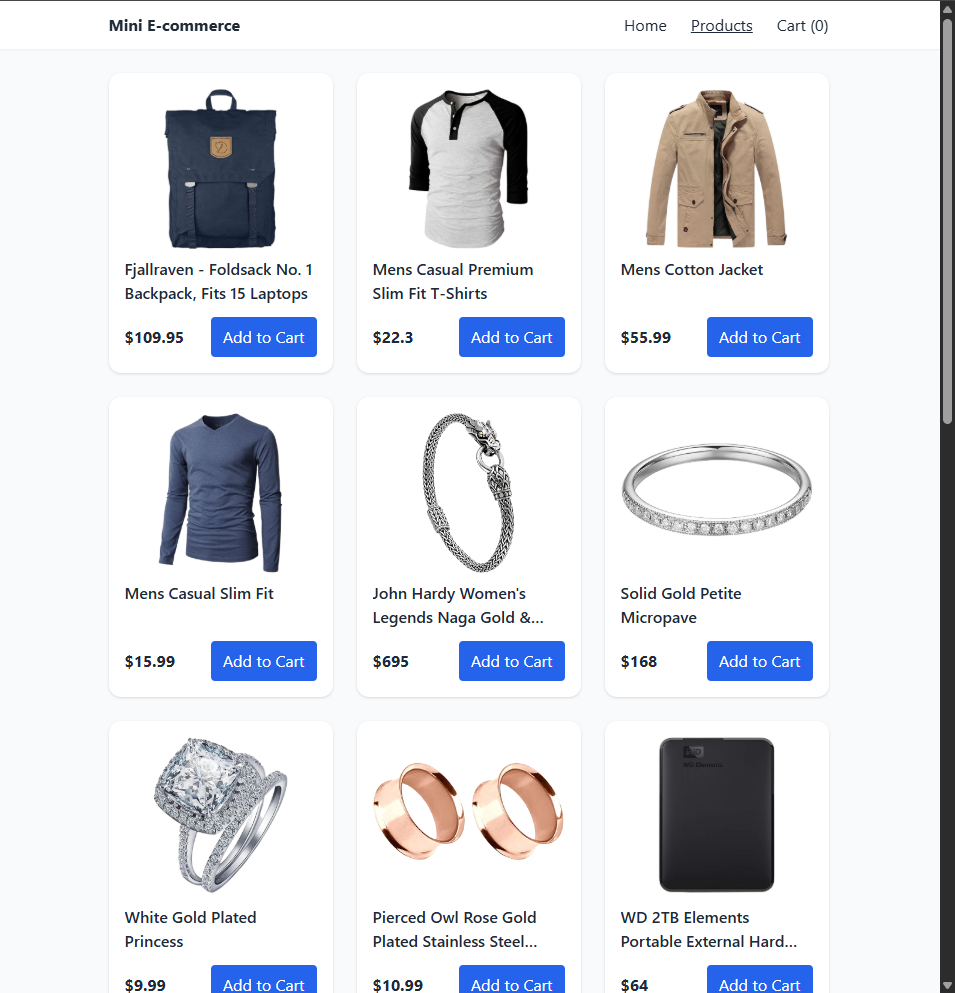
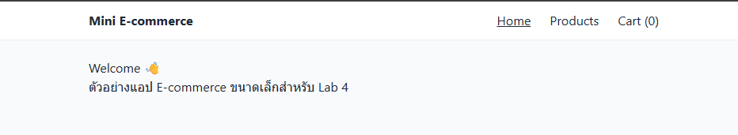
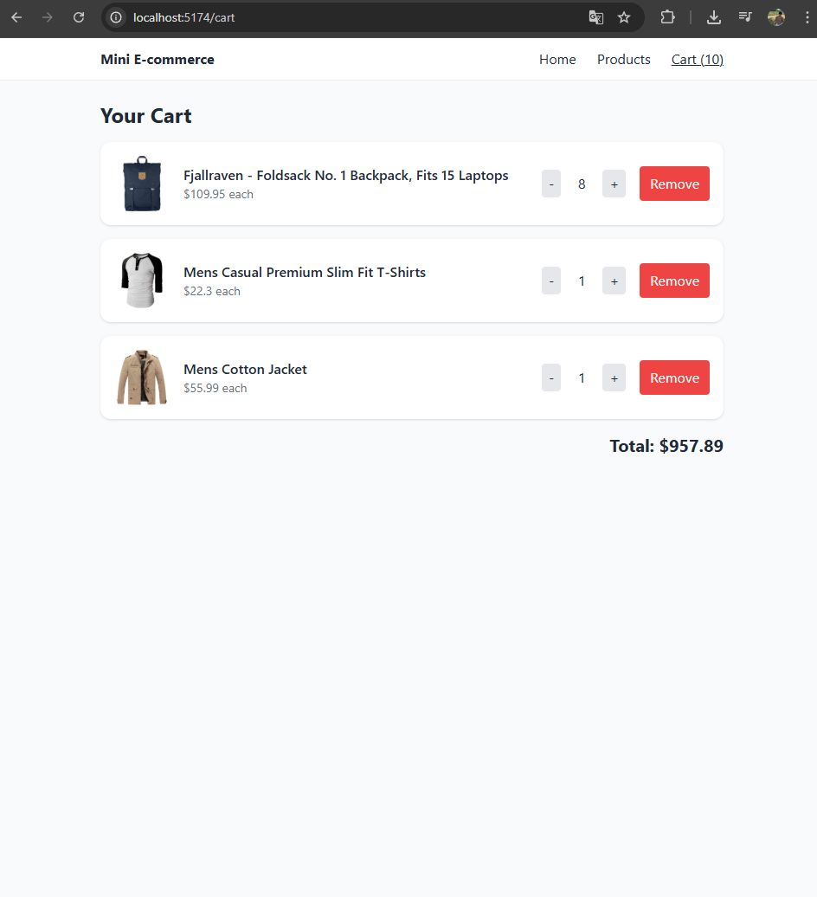
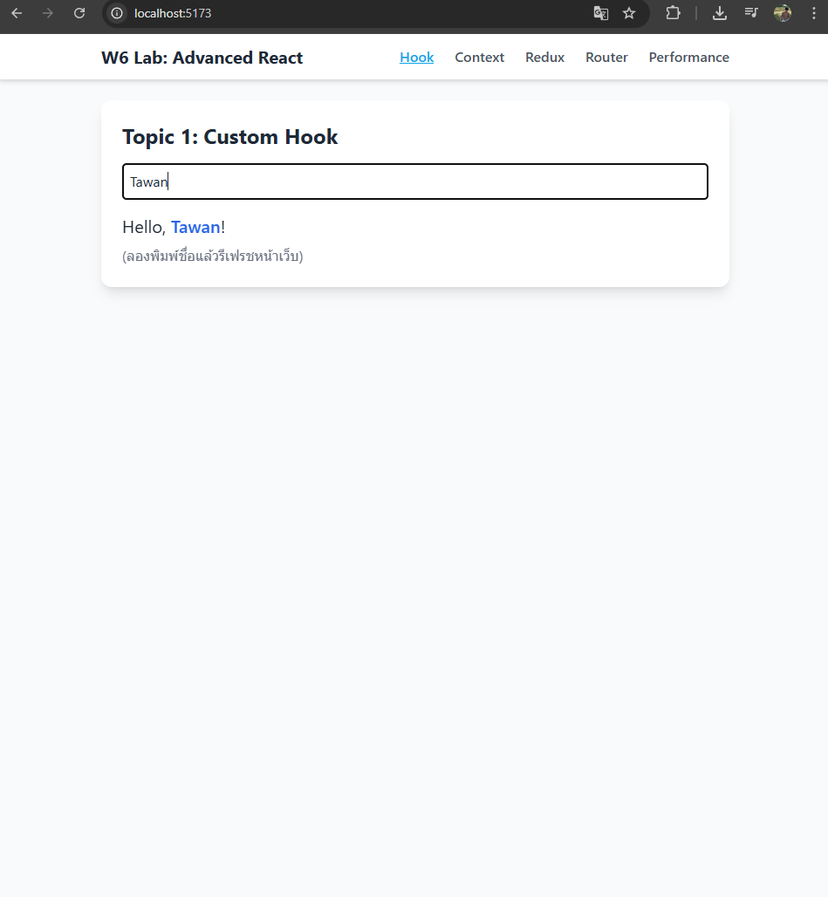
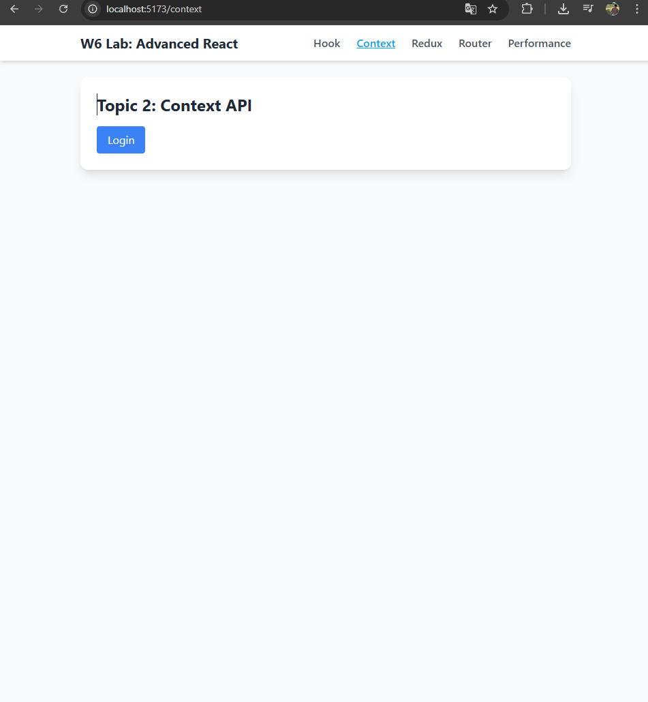
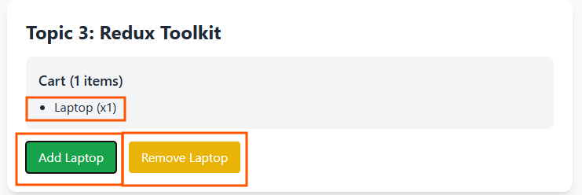
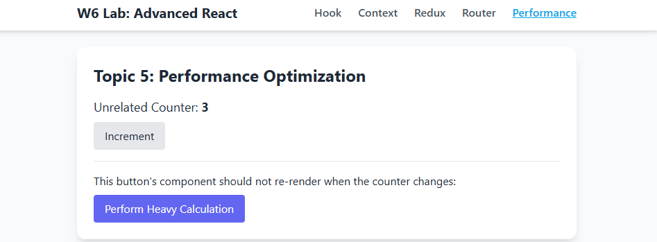

# Advanced React & Mini E-commerce

**Two React apps from a lab on advanced React: a set of focused demos (custom hooks, Context, Redux Toolkit, routing, memoisation), and a mini e-commerce store that applies them all with live product data and a Redux cart.**


> **ENGSE203 Computer Programming for Software Engineers, Lab 4**, semester 1/2568, RMUTL.

## Mini E-commerce (`mini-ecommerce/`)

| Home | Products | Cart |
|---|---|---|
|  |  |  |

- **Live catalogue** from [FakeStore API](https://fakestoreapi.com) via axios, with loading and error states
- **Redux Toolkit cart** (`features/cart/cartSlice.js`): add, change quantity, remove, running total
- **Dynamic routes:** `/products/:id` detail pages with React Router
- **Responsive** Tailwind layout; `React.memo` on product cards to avoid unnecessary re-renders

```
src/
  components/      Layout, ProductCard (memoised)
  features/cart/   cartSlice — Redux Toolkit
  pages/           Home, ProductList, ProductDetail, Cart
  store/           configureStore
```

## Advanced React demos (`react-lab-w6/`)

| Topic | What it shows | APIs |
|---|---|---|
| Custom hook | `useLocalStorage`: state that survives a page refresh | `useState`, `useEffect` |
| Context API | App-wide login/logout without prop drilling | `createContext`, `useContext` |
| Redux Toolkit | Global shopping-cart state | `createSlice`, `useSelector`, `useDispatch` |
| React Router | Pages and URL parameters | `Routes`, `Route`, `useParams` |
| Performance | Stopping child re-renders when props don't change | `React.memo`, `useCallback` |

| Custom hook | Context (login) | Redux | Performance |
|---|---|---|---|
|  |  |  |  |

## Run

```bash
git clone https://github.com/tawan230666/engse203-lab4-monorepo.git
cd engse203-lab4-monorepo

cd mini-ecommerce && npm install && npm run dev     # the store
cd react-lab-w6   && npm install && npm run dev     # the demos
```

---

**Author:** Tawan Tiphkun (ธาวัน ทิพคุณ), 67543210033-6, [@tawan230666](https://github.com/tawan230666), Software Engineering, RMUTL Chiang Mai
